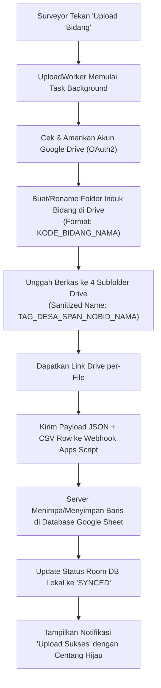

# Skema Sinkronisasi Web, Google Drive & Penempatan Tanda Tangan
**Aplikasi Inventarisasi ROW PLN (Android Mobile & Web Sync)**

Dokumen ini memuat spesifikasi teknis lengkap mengenai alur sinkronisasi data, hierarki folder Google Drive, konvensi penamaan file, aturan tanda tangan digital (TTD), dan skema JSON Webhook untuk diintegrasikan dengan Website / Google Apps Script.

---

## 1. Skema Hierarki Folder Google Drive

Setiap kali data bidang diunggah dari aplikasi, `UploadWorker` akan membuat / menggunakan hierarki berjenjang di Google Drive sebagai berikut:

```text
[Root Folder Jalur Transmisi]
 └── DESA <NAMA_DESA>
      └── SPAN <NOMOR_SPAN>
           └── <KODE_BIDANG>_<NAMA_PEMILIK>
                ├── 1. Dokumentasi Lapangan dan Foto Warga
                ├── 2. Berkas
                ├── 3. Dokumen
                └── 4. Form Invent
```

> [!NOTE]
> Jika `Nama Pemilik` atau `Nomor Bidang (NOBID)` diubah di aplikasi, sistem secara otomatis melakukan **Rename** pada folder induk `<KODE_BIDANG>_<NAMA_PEMILIK>` di Google Drive menggunakan API `driveService.files().update()` tanpa mengubah ID folder maupun merusak file di dalamnya.

---

## 2. Aturan Penamaan File (*Sanitized Naming Convention*)

Semua file yang diunggah diberi nama dengan pola standar:
$$\text{<TAG>\_<DESA>\_<SPAN>\_<NOBID>\_<NAMA\_PEMILIK>.<ext>}$$

### Aturan Sanitasi Teks (*Sanitizer Rules*):
1. **Tanda Titik (`.`):** Dihilangkan total dari seluruh teks (`DESA`, `SPAN`, `NOBID`, `NAMA`) agar tidak mengganggu penunjuk ekstensi file.
2. **Karakter Terlarang:** Karakter khusus seperti `/`, `\`, `:`, `*`, `?`, `"`, `<`, `>`, `|`, `%`, `#`, `&`, `+`, `=`, `;`, `@` dibuang total.
3. **Pemisah Strip (`-`):** Dikonversi menjadi `_`.
4. **Ekstensi File:** Hanya ada **satu tanda titik** pada akhir nama file untuk ekstensi (`.jpg`, `.png`, atau `.pdf`).

### Tabel Distribusi File ke Subfolder Drive

| Subfolder Tujuan | Tag File | Jenis Dokumen | Contoh Nama File |
| :--- | :--- | :--- | :--- |
| **`1. Dokumentasi Lapangan dan Foto Warga`** | `BIDANG_1` | Foto Fisik Lahan Utama (Stempel GPS) | `BIDANG_1_BURU_T12_T14_12_SUTRISNO.jpg` |
| | `BIDANG_1_RAW` | Foto Fisik Lahan Utama (Original) | `BIDANG_1_RAW_BURU_T12_T14_12_SUTRISNO.jpg` |
| | `BIDANG_2` | Foto Fisik Lahan 2 | `BIDANG_2_BURU_T12_T14_12_SUTRISNO.jpg` |
| | `BIDANG_3` | Foto Fisik Lahan 3 | `BIDANG_3_BURU_T12_T14_12_SUTRISNO.jpg` |
| | `WAJAH_PATOK` | Foto Wajah Pemilik / Patok | `WAJAH_PATOK_BURU_T12_T14_12_SUTRISNO.jpg` |
| **`2. Berkas`** | `KTP` | Foto / Scan KTP Pemilik | `KTP_BURU_T12_T14_12_SUTRISNO.jpg` |
| | `KK` | Foto / Scan Kartu Keluarga | `KK_BURU_T12_T14_12_SUTRISNO.pdf` |
| | `ALAS_HAK` | Sertipikat / Letter C / SPPT / SKT | `ALAS_HAK_BURU_T12_T14_12_SUTRISNO.jpg` |
| | `PERALIHAN_HAK` | Dokumen Peralihan Hak | `PERALIHAN_HAK_BURU_T12_T14_12_SUTRISNO.pdf` |
| | `JUAL_BELI` | Akta Jual Beli (AJB) | `JUAL_BELI_BURU_T12_T14_12_SUTRISNO.pdf` |
| | `KETERANGAN_WARIS` | Surat Keterangan Waris | `KETERANGAN_WARIS_BURU_T12_T14_12_SUTRISNO.pdf` |
| | `KUASA_WARIS` | Surat Kuasa Waris | `KUASA_WARIS_BURU_T12_T14_12_SUTRISNO.pdf` |
| | `SURAT_KUASA` | Surat Kuasa Umum | `SURAT_KUASA_BURU_T12_T14_12_SUTRISNO.pdf` |
| | `KET_BEDA_NAMA` | Surat Keterangan Beda Nama | `KET_BEDA_NAMA_BURU_T12_T14_12_SUTRISNO.pdf` |
| | `WAKAF` | Akta Ikrar Wakaf | `WAKAF_BURU_T12_T14_12_SUTRISNO.pdf` |
| | `KLAIM_TANAMAN` | Surat Klaim Tanaman | `KLAIM_TANAMAN_BURU_T12_T14_12_SUTRISNO.pdf` |
| | `KLAIM_BANGUNAN` | Surat Klaim Bangunan | `KLAIM_BANGUNAN_BURU_T12_T14_12_SUTRISNO.pdf` |
| | `DOKUMEN_LAIN` | Berkas Pendukung Lainnya | `DOKUMEN_LAIN_BURU_T12_T14_12_SUTRISNO.pdf` |
| **`3. Dokumen`** | `TTD_TIM_1` | Tanda Tangan Tim Pelaksana 1 | `TTD_TIM_1_BURU_T12_T14_12_SUTRISNO.png` |
| | `TTD_TIM_2` | Tanda Tangan Tim Pelaksana 2 | `TTD_TIM_2_BURU_T12_T14_12_SUTRISNO.png` |
| | `TTD_PEMILIK` | Tanda Tangan Pemilik Lahan | `TTD_PEMILIK_BURU_T12_T14_12_SUTRISNO.png` |
| | `TTD_SAKSI_1` | Tanda Tangan Saksi 1 | `TTD_SAKSI_1_BURU_T12_T14_12_SUTRISNO.png` |
| | `TTD_SAKSI_2` | Tanda Tangan Saksi 2 | `TTD_SAKSI_2_BURU_T12_T14_12_SUTRISNO.png` |
| | `TTD_KADES` | Tanda Tangan Kepala Desa / Lurah | `TTD_KADES_BURU_T12_T14_12_SUTRISNO.png` |
| | `CAP_DESA` | Stempel / Cap Resmi Desa | `CAP_DESA_BURU_T12_T14_12_SUTRISNO.png` |
| **`4. Form Invent`** | `FORM_INVENT` | PDF Laporan Resmi Formulir Inventarisasi | `FORM_INVENT_BURU_T12_T14_12_SUTRISNO.pdf` |

---

## 3. Spesifikasi & Tata Letak Tanda Tangan Digital (TTD)

Tanda tangan ditangkap secara digital menggunakan `Canvas` pada aplikasi Android, dicrop ketat (*Tightly Cropped*), dan diekspor ke format PNG transparan.

### A. Spesifikasi Dimensi Ekspor PNG TTD

| Jenis Tanda Tangan | Dimensi Piksel | Rasio | Format | Keterangan |
| :--- | :--- | :--- | :--- | :--- |
| **Kepala Desa / Lurah (`TTD_KADES`)** | **`450 x 225 px`** | `2 : 1` | `PNG` | Menyediakan ruang ekstra untuk stempel desa |
| **Cap / Stempel Desa (`CAP_DESA`)** | **`300 x 300 px`** | `1 : 1` | `PNG` | Format lingkaran / stempel transparan |
| **Tim Pelaksana 1 & 2 (`TTD_TIM_1`, `TTD_TIM_2`)** | **`400 x 200 px`** | `2 : 1` | `PNG` | Ukuran standar kotak TTD |
| **Saksi 1 & 2 (`TTD_SAKSI_1`, `TTD_SAKSI_2`)** | **`400 x 200 px`** | `2 : 1` | `PNG` | Ukuran standar kotak TTD |
| **Pemilik Lahan (`TTD_PEMILIK`)** | **`400 x 200 px`** | `2 : 1` | `PNG` | Ukuran standar kotak TTD |

---

### B. Tata Letak Matriks TTD pada Formulir Inventarisasi (Halaman 2 / Cetak PDF)

Di bagian bawah lembar Laporan Formulir Inventarisasi Lahan (Halaman 2), TTD ditempatkan dalam **Matriks 3 Kolom × 2 Baris**:

```text
+----------------------------+----------------------------+----------------------------+
|      TIM PELAKSANA 1       |      TIM PELAKSANA 2       |       PEMILIK LAHAN        |
|                            |                            |                            |
|     [ TTD_TIM_1.png ]      |     [ TTD_TIM_2.png ]      |    [ TTD_PEMILIK.png ]     |
|                            |                            |                            |
|   ( ADITYA ALIF AL F. )    |   ( ARDINE BAGUS F. )      |    ( NAMA_PEMILIK )        |
+----------------------------+----------------------------+----------------------------+
|          SAKSI 1           |          SAKSI 2           |    KEPALA DESA / LURAH     |
|                            |                            |                            |
|     [ TTD_SAKSI_1.png ]    |     [ TTD_SAKSI_2.png ]    |   [ TTD_KADES + CAP ]      |
|                            |                            |                            |
|        ( WIDADA )          |     ( RISKI WARDANI )      |       ( PUNADI )           |
+----------------------------+----------------------------+----------------------------+
```

> [!IMPORTANT]
> Pada kotak **Kepala Desa**, gambar `CAP_DESA.png` di-overlay dengan transparansi (opacity 85%) menimpa bagian kiri TTD `TTD_KADES.png` untuk mensimulasikan stempel basah asli.

---

## 4. Skema Payload Webhook JSON (Android ➔ Web / Google Apps Script)

Saat aplikasi melakukan pengiriman data ke Web/Server, HTTP POST request dikirimkan ke URL Webhook dengan format JSON berikut:

```json
{
  "action": "appendInventory",
  "spreadsheetId": "1INnTZ-CNAQ_eLHrjhEbLobk90KNLNn0SKuWc9YODQHs",
  "targetFolderId": "18NzOd1GbknDDQtEJsOn8KL6cc7C5-jD7",
  "code": "BURU_T12_T14_12",
  "idUnik": "a8f3c4e1-2b9d-4e5a-8721-9a01f8e23456",
  "csvRow": "BURU_T12_T14_12;DESA BURU;SPAN T.12-T.14;12;1500;SAKSI;...;https://drive.google.com/...",
  "photos": [
    {
      "tag": "KTP",
      "fileName": "KTP_BURU_T12_T14_12_SUTRISNO.jpg",
      "base64": "/9j/4AAQSkZJRgABAQAAAQABAAD..."
    },
    {
      "tag": "TTD_PEMILIK",
      "fileName": "TTD_PEMILIK_BURU_T12_T14_12_SUTRISNO.png",
      "base64": "iVBORw0KGgoAAAANSUhEUgAAAZAAA..."
    }
  ]
}
```

### Respon Sukses dari Web/Server (JSON Output):
```json
{
  "status": "success",
  "message": "Data bidang BURU_T12_T14_12 berhasil disimpan ke Google Sheets & Drive",
  "driveFolderUrl": "https://drive.google.com/drive/folders/1abc...",
  "linkBidang1": "https://drive.google.com/file/d/1xyz.../view",
  "linkKtp": "https://drive.google.com/file/d/2abc.../view",
  "linkSigPemilik": "https://drive.google.com/file/d/3def.../view"
}
```

---

## 5. Ringkasan Alur Kerja Pengolahan Data di Web Server



---
*Dokumen ini disusun otomatis sesuai implementasi aktual pada sistem Inventarisasi ROW PLN.*
